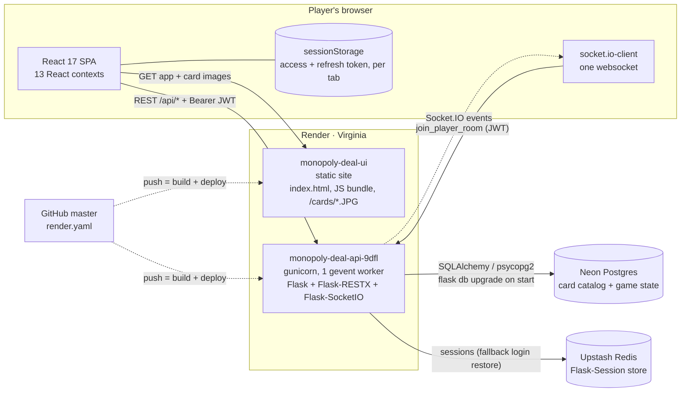
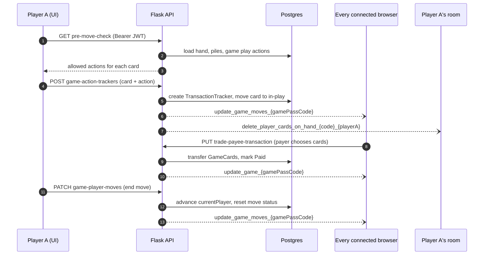
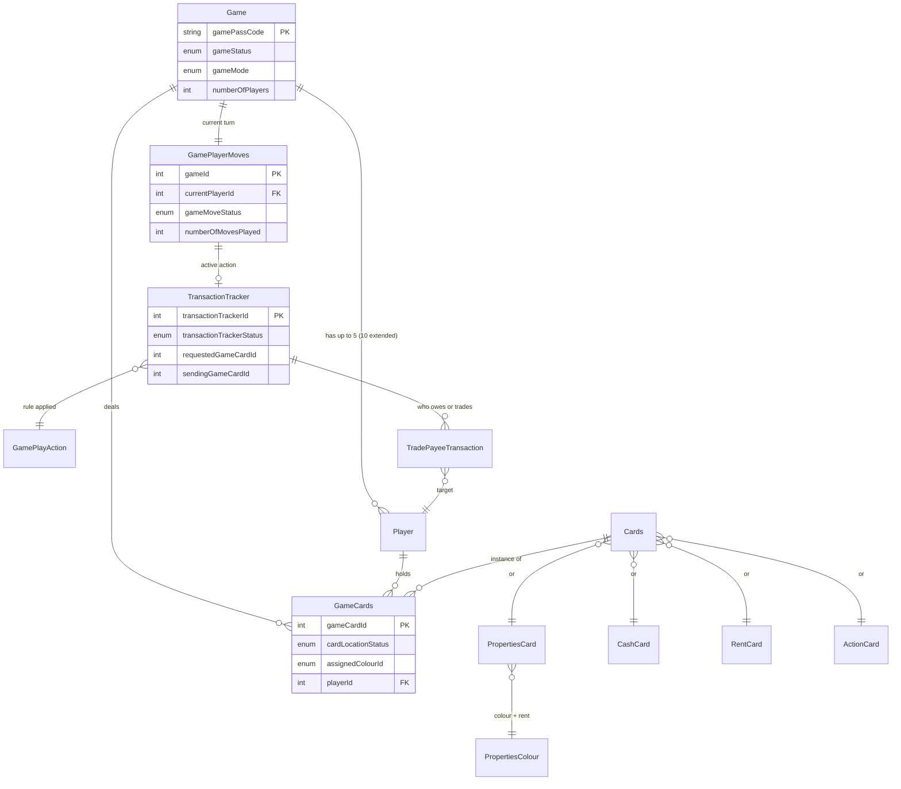

# Architecture

A React single-page app talks to a Flask REST API over HTTPS and gets live game updates over Socket.IO. Both run on [Render](https://render.com), deployed from `master` by the [`render.yaml`](../render.yaml) blueprint. Game state lives in Neon Postgres; Upstash Redis backs the optional cookie session.

- App: https://monopoly-deal-ui.onrender.com/
- API docs (Swagger): https://monopoly-deal-api-9dfl.onrender.com/documentation/

## System overview



| Piece | What it does |
|---|---|
| `monopoly-ui` | Create React App build served as a static site. The API URL is baked in at build time (`REACT_APP_API_BASE_URL`). Unknown paths rewrite to `index.html`; card images are plain files under `public/cards`. |
| `monopoly-api` | Flask 2.0 app with 16 Flask-RESTX namespaces, JWT auth (`flask-jwt-extended`), Socket.IO (`Flask-SocketIO`) and SQLAlchemy 1.3 with Alembic migrations. Runs one gevent worker, which the per-game write lock relies on. |
| Neon Postgres | 7 catalog tables (the fixed 106-card deck and its rules) and 6 per-game tables. |
| Upstash Redis | Server-side session for the `MONOPOLY-DEAL` cookie. Only used to restore a login when the browser has no stored tokens. |

## How a move travels

The UI never decides the rules. It asks the API which actions each card allows (the four *move-check* endpoints), sends the move, and redraws when the Socket.IO event arrives. This is a player playing a card such as Debt Collector:



Game and turn events go to every connected browser because they only contain public table state. Hand events go only to the player's private room (see [Auth and realtime](#auth-and-realtime)).

## Data model

A card in play is a `GameCards` row: `cardLocationStatus` says where it sits (deck, hand, cash pile, property pile, in play, discarded) and `playerId` says whose it is.



Schema changes go through Alembic: edit `monopoly-api/monopoly/models.py`, run `flask db migrate -m "..."`, and commit the new file in `monopoly-api/migrations/versions/`. Render runs `flask db upgrade` on every start.

## API surface

Routes are nested under the game's pass code. Responses carry absolute `links`, and the UI follows them instead of building URLs.

| Area | Routes under `/api` | Auth | Purpose |
|---|---|---|---|
| Lobby | `/games/`, `/games/{code}/` | public; JWT for start/delete | List and create games; start one; the host can delete it |
| Players | `…/register/`, `login/`, `refresh/`, `vote/` | public; refresh token; JWT | Join a game, get tokens, vote to start |
| Session | `/sessions/`, `/logout/` | cookie | Fallback login restore through the Redis session |
| Cards | `/cards/`, `/game-play-actions/` | public; game code | Static deck and rules catalog |
| Your hand | `…/player-cards/`, `draw-cards/` | JWT | Read your hand; draw cards at the start of a turn |
| Table | `…/game-cards/`, `game-player-moves/` | game code; JWT | Cards on the table; turn state and end of move |
| Rule checks | `…/pre-move-check/`, `in-play-`, `selection-`, `property-move-check/` | JWT | Which actions each card allows right now |
| Actions | `…/game-action-trackers/{id}/`, `…/trade-payee-transaction/` | JWT | Rent, debt, birthday, sly/forced deal, Just Say No, payments |

### Socket.IO events

| Event | Sent when | Listened to by | Who receives it |
|---|---|---|---|
| `create_game`, `update_game` | Game created, player joins, game starts | `GamesListContext` | Everyone (lobby list) |
| `update_game_{code}` | Any table change | `GameContext` | Everyone (public table state) |
| `create_game_moves_{code}`, `update_game_moves_{code}` | Turn starts, action or payment progresses | `GameMoveContext` | Everyone (public table state) |
| `add_` / `update_` / `delete_player_cards_on_hand_{code}_{playerId}` | Draw, play, pay, trade | `CurrentPlayerCardsOnHandContext` | That player only (private room) |
| `join_player_room`, `leave_player_room` (client → server) | Board mounts, reconnects, unmounts | `CurrentPlayerCardsOnHandContext` | Acknowledged to the sender |

## Auth and realtime

- **Login:** `register` / `login` return an access token (1 hour) and a refresh token (24 hours). Both carry `playerId` and `gamePassCode`.
- **Authorization:** `validate_player` trusts the signed JWT and checks its `gamePassCode` against the URL. There's no cookie dependency, because the UI and API are on different sites and many browsers block third-party cookies.
- **Tokens in the browser:** kept in `sessionStorage`, one player per tab (`monopoly-ui/src/common/tokenStorage.js`). A reload restores the player from there, refreshing the access token if it expired. During play, an axios interceptor refreshes an expired token once and retries the call (`monopoly-ui/src/api/axiosInstance.js`).
- **Private hands:** the browser emits `join_player_room` with its access token. The API verifies it and joins the socket to `player_{code}_{playerId}`; the room comes from the token, never from the client (`monopoly-api/monopoly/sockets.py`). Hand events are emitted only to that room.
- **Concurrent moves:** state-changing handlers run one at a time per game (`monopoly-api/monopoly/locks.py`). The lock is in-process, so it relies on the single gunicorn worker.

## Frontend structure

```text
SocketContextProvider          one socket, created once
└ Router
  └ PlayerContextProvider      tokens <-> sessionStorage
    ├ /                 Home
    ├ /new-game         NewGame
    ├ /games-list       GamesListContext
    └ /:code/join-game | game-board
      └ GameContextProvider    GET game + update_game_{code}
        └ GameBoardTemplate
          └ GameMove > PropertyMoveCheck > PreMoveCheck > InPlayMoveCheck >
            SelectionMoveCheck > TradeTransaction > CurrentPlayerCards
              └ GameBoardArea, piles, hand
```

| Folder | Contents |
|---|---|
| `src/api/` | Thin axios wrappers, one per resource, plus the shared instance with the refresh interceptor |
| `src/context/` | Providers with reducers and Socket.IO listeners (each `socket.on` has a matching `socket.off`) |
| `src/components/` | Atomic design: 26 atoms, 12 molecules, 10 organisms, 2 templates |
| `src/pages/` | 6 route pages |
| `src/common/` | Enums mirrored from the API, move helpers, token storage |
| `public/cards/` | The 106 card images |

## Testing and CI

- API: `cd monopoly-api && pip install -r requirements-dev.txt && python -m pytest tests -q`. Tests run on SQLite with fakeredis, so no services are needed.
- UI: `cd monopoly-ui && npm test -- --watchAll=false`.
- GitHub Actions (`.github/workflows/ci.yml`) runs both and builds the UI on every push to `master` and every pull request.

## Known limitations

- **Single worker:** the per-game lock and Socket.IO rooms live in one process. Running more than one worker needs a shared lock and a Socket.IO message queue (for example Redis).
- **Cold starts:** Render's free tier sleeps the API after about 15 idle minutes; the first request then takes about 50 seconds.
- **Ageing stack:** Python 3.9, Flask 2.0 (with a compatibility patch for flask-restx 0.2), SQLAlchemy 1.3, Create React App 4 on Node 16, React 17 and React Router 5. An upgrade is planned as a separate change.
